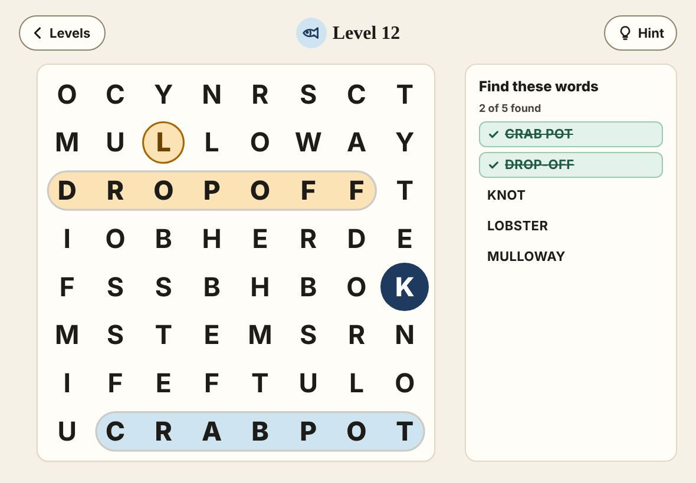
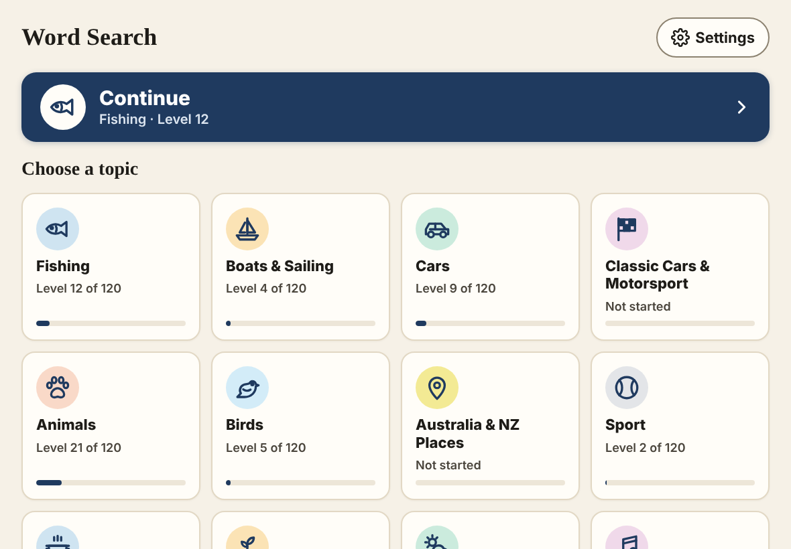
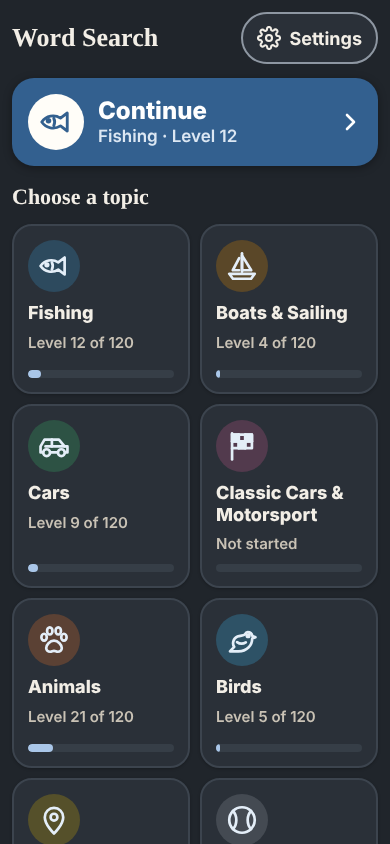

# Word Search

A free, friendly word search game for iPad, built to work **with no internet** once it's installed. It has big letters, calm colours, and no timers, scores, ads or accounts.

It started as a game for someone spending a long stretch in hospital, where the Wi-Fi comes and goes. Anyone is welcome to use it.

**Play it here: <https://i-higgins.github.io/word-search/>**



<details>
<summary>More screenshots</summary>




</details>

## What's in it

- **16 topics**, each with **120 levels**: Fishing, Boats & Sailing, Cars, Classic Cars & Motorsport, Animals, Birds, Australia & NZ Places, Sport, Food & Cooking, Garden & Plants, Weather & Nature, Music, Around the House, Space, Ocean & Beach, Trees & Flowers. Words use Australian/NZ spelling.
- **Two ways to select a word:** tap the first letter and then the last letter, or slide your finger along the word.
- **Gentle difficulty.** Levels 1–20 use an 8×8 grid with words going across and down. Diagonals come in at level 21, backwards words at 51, and every direction from level 81.
- **Unlimited hints.** A hint highlights the first letter of a word. There's no penalty for using one.
- **Settings:** three text sizes; Light, Dark (follows the device unless you choose) or High contrast colours; soft sounds (off by default).
- **Saves automatically** after every word, and reopens exactly where you left off.
- **Works offline.** Every file is saved on the device the first time the app opens.

## Installing on iPad

1. Open **<https://i-higgins.github.io/word-search/>** in **Safari**. Other browsers on iPad can't install it.
2. Tap the **Share** button (the square with an arrow pointing up).
3. Choose **Add to Home Screen**, then **Add**.
4. **Open it once from the new home-screen icon while you're still on Wi-Fi.** This saves the game on the iPad for offline use. After that it works with Wi-Fi off.

> **Note:** a home-screen app keeps its own progress, separate from Safari. If you played a few levels in a Safari tab first, that progress won't carry over to the icon. Just start playing from the icon.

It also works on iPhone the same way, and in any modern browser on a computer.

### Tip: lock the iPad to the game (Guided Access)

Guided Access stops accidental taps from leaving the game. This helps if someone is tired, on medication, or not used to an iPad.

1. Go to **Settings → Accessibility → Guided Access** and turn it **on**. Set a passcode when it asks.
2. Open Word Search from the home screen.
3. **Triple-click** the top button (or the Home button on older iPads), then tap **Start**.
4. To finish, triple-click again and enter the passcode.

## Privacy

Nothing leaves the device. There's no backend, no accounts, no analytics, no ads, no tracking and no outside requests. Progress and settings are stored in the browser's local storage on the iPad. The app asks the browser to keep that storage persistent, where the browser supports it.

## Running it locally

There's no build step. It's plain HTML, CSS and JavaScript (ES modules), so any static web server works:

```bash
npm start
```

That serves the app at <http://localhost:8080/> with the included zero-dependency server. Python works too:

```bash
python3 -m http.server 8080
```

Service workers need `localhost` or HTTPS. Opening `index.html` straight from the file system won't work offline.

## Tests

Requires Node 20+.

```bash
npm install
```

Validate the word lists and run the unit tests (determinism, every category × levels 1–150, profanity check, precache list):

```bash
npm test
```

End-to-end tests in Chromium and WebKit with an iPad viewport and touch. They cover tap-tap, drag, backwards words, reload persistence, offline play and the update banner:

```bash
npx playwright install chromium webkit
```

```bash
npm run test:e2e
```

To screenshot every screen and state in every theme and viewport, with side-by-side comparisons against the design, run the command below. The output goes to `screenshots/`.

```bash
npm run screenshots
```

To regenerate the PNG app icons from `icons/src/*.svg`:

```bash
npm run icons
```

## How it works

| Path | What it is |
| --- | --- |
| `index.html` | The single page. Loads `js/app.js`. |
| `css/tokens.css` | Design tokens (colours, type, spacing), one block per theme. |
| `css/app.css` | Layout and components. Uses only the tokens. |
| `js/generator.js` | Seeded puzzle generator (mulberry32). Level *N* of a topic is the same puzzle on every device, and puzzles are never stored. |
| `js/blocklist.js` | Words that must never appear by accident in a grid, in any direction. |
| `js/input.js` | Tap-tap and drag selection using Pointer Events. |
| `js/storage.js` | Progress and settings in `localStorage`. Every access is wrapped in try/catch. |
| `js/app.js` | Screens, routing, game, service worker registration. |
| `data/categories.js` | All the word lists. Easy to edit. |
| `sw.js` | Service worker: precaches every app file and serves cache-first. |
| `design/` | The design export, for reference only. Never served or precached. |

### Deploying

Pushing to `main` runs `.github/workflows/pages.yml`. It runs the unit tests, copies only the app files into `_site/`, stamps the service worker with the commit id, and publishes to GitHub Pages. A new version shows a **"A new version is ready"** banner on the Home and Levels screens only, never mid-puzzle.

The first time, turn on Pages in the repo: **Settings → Pages → Build and deployment → Source: GitHub Actions**.

If you fork it, change `SOURCE_URL` in `js/app.js` and the URLs in this README.

## Contributing

New topics and word fixes are very welcome. See [CONTRIBUTING.md](CONTRIBUTING.md).

## Licence

[MIT](LICENSE)
